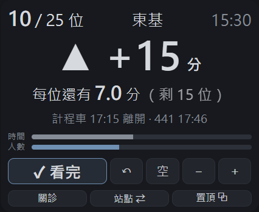
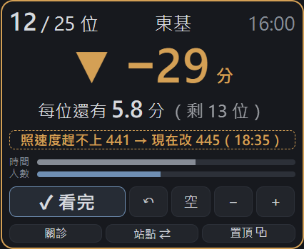

# clinic-pacer

門診看診進度的置頂小視窗：每看完一位按一下，它照你目前的速度算「會不會趕不上回程的火車」。

寫給外院支援門診：看完要趕固定一班火車回去，又不想邊看診邊心算「還剩幾位、每位還能看幾分鐘」。
這件事交給這個小視窗：它浮在其他視窗上面，大字告訴你照現在的速度會早到還是遲到幾分鐘，
真的趕不上時提早提醒你改搭下一班。

| 照速度來得及（▲ +15 分） | 照速度會晚，提醒改票（▼ −29 分） |
| --- | --- |
|  |  |

## 特色

- **單一 HTML 檔**：不用安裝、不用帳號、不連網路。放 USB 或雲端硬碟，到哪台電腦都能開。
- **置頂小視窗**：用瀏覽器的 Document Picture-in-Picture，小視窗會浮在所有視窗上面（Chrome／Edge 116 以上）。
- **只記按鍵時間與人數**：不輸入、不儲存任何病人資料。紀錄只存在那台電腦瀏覽器的 localStorage 裡。
- **多個站點**：每個門診地點各自設定開診時間、最晚離開時間、車次、備選車次。

## 怎麼用

1. 下載 [`clinic-pace.html`](clinic-pace.html)（這一個檔案就是全部）。
2. 雙擊打開（或拖進 Chrome／Edge）。
3. 按「開啟置頂小視窗」，小視窗就會浮在其他程式上面。舊瀏覽器不支援的話會退成一般小視窗（不會置頂）。
4. 看完一位按 **✓ 看完**；按錯按 **↶**；沒人候診時按 **空**（這段空檔不算進速度）；總人數用 **−／＋** 調整。
   小視窗在前面時也可以用鍵盤：空白鍵／Enter＝看完、Backspace＝撤銷、I＝空檔、+／-＝人數。

關掉重開會接著算，隔天自動歸檔。主畫面可以「匯出紀錄（JSON）」。

### 畫面怎麼看

- **▲ +9**：照目前速度，會比最晚離開時間早 9 分鐘。
- **●**：差不多（±5 分以內）。
- **▼ −19**：會晚 19 分鐘（大字變琥珀色、視窗加細框）。
- **每位還有 x 分**：剩下的病人平均每位還能用幾分鐘。
- 落後超過 10 分、而且離開車還有一小時以上時，會提示「照速度趕不上 → 現在改搭下一班」。
- 接近離開時間會亮「叫車！」或「準備走！」。

## 站點設定怎麼改

打開 `clinic-pace.html` 主畫面下方的「站點設定」表格，直接改，改完自動存在這台電腦的瀏覽器裡：

| 欄位 | 意思 | 例 |
| --- | --- | --- |
| 站點 | 名稱 | 東基 |
| 開診 | 開診時間 | 14:00 |
| 車次／開車 | 要搭的那班車與開車時間 | 441／17:46 |
| 離開方式／最晚離開 | 最晚要離開診間的時間，▲▼ 就是跟它比 | 計程車／17:15 |
| 備案方式／備案離開 | （可空）主要方式趕不上時的備案，例如派車趕不上就自己走 | 自己走／18:00 |
| 提醒提前 | 離開前幾分鐘提醒（0＝不提醒） | 5 |
| 預設人數 | 這個站點平常的掛號數 | 25 |
| 速度預設 | 還沒累積到 5 位時拿來補的每位分鐘數 | 8 |
| 備選車次 | 趕不上時可以改搭的車 | `445 18:35, 447 20:00` |
| 星期 | 哪天自動選這個站點（0＝週日） | 3 |

想把自己的站點寫成預設值，就改檔案裡的 `DEFAULT_SITES`（`<script id="pace-ui">` 開頭）。
「恢復預設站點」會回到 `DEFAULT_SITES`。

## 怎麼算

- 速度＝最近 5 個「看完」間隔的指數加權平均（EWMA，α＝0.4）；按過「空」的那段不算。
- 單一間隔超過速度預設的 3 倍視為極端值（例如中間被叫去處理別的事），權重壓到 0.3。
- 前 5 位還沒累積夠時，拿「速度預設」補。
- 預計看完時間＝現在＋剩餘人數 × 速度，再跟最晚離開時間比。有備案時，主要方式已經過了、或照速度會晚 5 分以上，就改跟備案比。

## 隱私

這個工具只記錄「你按下看完的時間」與「總人數」。不需要、也沒有欄位輸入病人姓名、病歷號或任何個人資料；
不連網路、不跟任何系統串接。資料只存在你用的那台電腦的瀏覽器裡，可以在主畫面「清掉今天這個站點」。

## 開發

- 單一檔案 `clinic-pace.html`：`<script id="pace-core">` 是算法（不碰 DOM），`<script id="pace-ui">` 是畫面。
- 算法測試：`node --test`（直接從 HTML 抽出 `pace-core` 來跑，測的就是實際用的那一份）。
- UI 冒煙測試＋截圖：`python tests/ui_check.py <輸出資料夾>`（需要 Playwright；會開一個有視窗的 Edge，跳出小視窗幾秒）。
  加 `--screen` 才會螢幕實拍小視窗周圍（會拍到其他視窗，有敏感畫面的電腦不要用）。

## 授權

[MIT](LICENSE) © Po-Wei Chen

---

## English

**clinic-pacer** is a tiny always-on-top window for outpatient clinics. Press one button each time you finish a patient;
it extrapolates your recent pace and tells you whether you will make your train home — e.g. **▲ +15 min** (ahead) or
**▼ −29 min** (behind, with a prompt to switch to a later train while there is still time).

- Single self-contained HTML file: no install, no account, no network access.
- Uses the Document Picture-in-Picture API to float above other windows (Chrome/Edge 116+).
- Stores only button-press timestamps and the patient count, in the browser's localStorage. No patient data is entered or stored.
- Pace = EWMA (α = 0.4) of the last 5 intervals, idle gaps excluded, outliers down-weighted.

Download `clinic-pace.html`, open it in Chrome or Edge, click the button to open the floating window, and edit the
site table (start time, latest departure, trains) to match your own clinic. The UI is in Traditional Chinese. MIT licensed.
